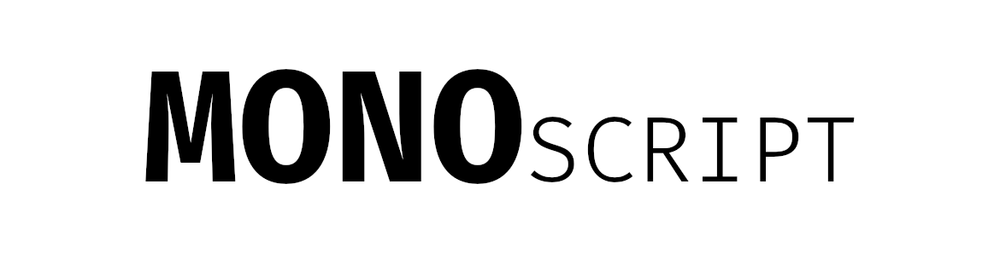

<div align="center">
  <a href="https://github.com/MONOPTICAL/MONOSCRIPT">
    
  </a>

<h3 align="center">MONOSCRIPT</h3>

  <p align="center">
    Convenient language for creating plugins for MONOPTICAL
    <br />
  </p>
  <hr>
</div>

**MONOSCRIPT** is an experimental, statically typed programming language with type inference, compiled through **LLVM**. It feels like a scripting language, runs instantly through a JIT, and can also be built into a native executable.

```go
[i64]fibonacci(i64: n) @strict @pure
|   if n < 2
|   |   return n
|   return fibonacci(n - 1) + fibonacci(n - 2)

[i32]main()
|   echo("fib(30) = " + fibonacci(30))
|   return 0
```

> 🚧 **Early development.** Numbers, strings, functions, loops, modules, arrays, maps and structs work today, through the JIT and in native executables. See [Current State](#-current-state).

## 💡 Why MONOSCRIPT?

MONOPTICAL needs plugins: small programs for security checks, scanning, data analytics and automation. They have to be quick to write, and they must not fail in surprising ways.

Scripting languages are quick to write, but type errors only show up when the code is already running. Systems languages catch those errors, but they are too heavy for a small plugin. MONOSCRIPT aims for the middle:

|Goal|How|
|---|---|
|Quick to write|Short syntax, type inference, run a file with one command|
|Hard to break|Static types, no silent narrowing, errors at compile time|
|Strict where it matters|Turn on `@strict` and `@pure` per function, not for the whole project|
|Fast|Native code through LLVM instead of an interpreter|
|Easy to extend|Add native functions in **D** with one entry in a TOML file|

## ✨ What Makes It Different

### 🏷️ Strictness Per Function

You choose how strict each function is. Quick code stays quick, and critical code gets stronger guarantees:

```go
[i32]quick()
|   i8 small = 5
|   i32 wide = small          // widens automatically
|   return wide

[i32]careful() @strict
|   i8 small = 5
|   i32 wide = small->i32     // @strict requires an explicit cast
|   return wide

[i32]main()
|   echo("" + quick() + careful())
|   return 0
```

### 🧼 Purity That Is Actually Checked

`@pure` is a promise the compiler enforces. A pure function cannot call impure functions, read globals or modify the objects passed to it:

```go
[string]label(i32: score) @pure
|   return "score: " + score    // OK

[void]report(i32: score) @pure
|   echo(label(score))          // compile error: echo is impure

[i32]main()
|   return 0
```

### 🔢 No Silent Narrowing

Widening is automatic. Anything that can lose data needs an explicit cast:

```go
[i32]main()
|   i32 big = 300
|   i64 wide = big          // OK
|   i8 small = big->i8      // OK: you asked for it
|   i8 oops = big           // compile error: use explicit cast ->i8
|   return 0
```

### 🧱 Visible Structure

Blocks start with `|`, so nesting is visible at a glance and does not depend on invisible whitespace:

```go
[i32]main()
|   for i in range(10)
|   |   if i % 2 == 0
|   |   |   echo("even: " + i)
|   return 0
```

### 🔌 Explicit Modules

Import a whole module, a single function or a function under an alias. Functions can stay `@private`, and replacing an imported function has to be intentional:

```go
use
|> http_server
|> math -> sqrt
|> math -> pow : power

[i32]helper() @overwrite    // without @overwrite, a name clash is a compile error
|   return 100
```

## 🧭 Paradigms

|Paradigm|Description|
|---|---|
|Imperative|`if`, `for`, `while`, mutable variables, step-by-step execution.|
|Modular|`use`, `@private` and `@overwrite`.|
|Structural|Custom `struct`s, no class inheritance.|
|Functional|Pure functions with `@pure`. Lambdas and pipes are planned.|

## 🔠 Data Types

### 📃 Primitive Types

- `i1` — boolean, `true` and `false`
- `i8`, `i16`, `i32`, `i64` — signed integers
- `float` — floating-point numbers
- `string` — text values
- `void` — absence of value (used for functions)

### 📦 Containers and Structs

- `array<T>` — arrays
- `map<K, V>` — key-value mappings
- `struct` — user-defined structures

Like in Python, numbers are copied, while objects are passed by reference. Use `copy(x)` when you need a separate shallow copy. Objects live on a garbage-collected heap, and a reference is never null.

```go
[i32]main()
|   array<i32> scores = [10, 20, 30]
|   scores[0] = 5
|   for score in scores
|   |   echo("score: " + score)
|
|   map<string, i32> ports = {"ssh": 22}
|   ports["http"] = 80
|   if has(ports, "ssh")
|   |   del(ports, "ssh")
|   for name in ports                // keys come in insertion order
|   |   echo(name + " = " + ports[name])
|
|   return len(scores) + len(ports)
```

Map keys are integers or strings. An index out of bounds, a missing map key, an integer division by zero, or a cast from `float` that does not fit stops the program with a message, the line number and exit code 101:

```
Runtime Error: index 3 out of bounds (len 3) at line 5
```

Integer addition, subtraction and multiplication wrap around on overflow, so `2147483647 + 1` in `i32` is `-2147483648`. The one integer operation that stops the program is dividing the smallest value of a type by `-1`.

### ⚙️ Typing

|Form|Example|
|---|---|
|Explicit type|`i32 count = 0`|
|Inferred type|`name ^= "value"`|
|Constant|`const i32 limit = 10`, `final limit ^= 10`|
|Assigned once, later|`final i32 limit`, then `limit = 10` on every path before it is read|
|Cast|`value->i8`|

## 📋 Syntax

### 🧪 Functions

The return type goes in square brackets, and the parameter type goes before its name:

```go
[i32]sum(i32: a, i32: b)
|   return a + b

[i32]main()
|   echo("1 + 2 = " + sum(1, 2))
|   return 0
```

### 🧱 Operators

|Operator|Meaning|
|---|---|
|`=`|Assignment|
|`^=`|Declaration with inferred type|
|`+ - * / %`|Arithmetic, `+` also joins strings|
|`== != > < >= <=`|Comparison of numbers and strings|
|`and or !`|Logical operations|
|`->`|Cast|

### ⚖️ Control Structures

- `if`, `else if`, `else`
- `for i in range(n)`, `for x in array`, `for key in map`
- `while ...`
- `break`, `continue`

### 🏷️ Labels

Labels go after the function declaration:

|Label|Effect|
|---|---|
|`@entry`|Marks the entry point instead of `main`|
|`@strict`|No implicit casts and no type inference|
|`@pure`|No side effects, checked by the compiler|
|`@private`|Hidden from imports|
|`@overwrite`|Replaces an imported function on purpose|

### 🧰 Structs

```go
[struct]User
|   i32 age = 18
|   string name = "anon"

[void]birthday(User: user)
|   user.age = user.age + 1

[i32]main()
|   User user = User()
|   birthday(user)
|   return user.age
```

## 📍 Current State

|Feature|Status|
|---|---|
|Numbers, strings, operators and casts|✅ Working|
|`if`, `while`, `for i in range(n)`|✅ Working|
|Functions, recursion, calling before declaration|✅ Working|
|Modules, `@strict`, `@pure`, `@entry`|✅ Working|
|JIT and native executables|✅ Working|
|Arrays: literals, nesting, `a[i]`, `len`, `for x in array`, bounds checks|✅ Working|
|Maps: `m[k]`, `has`, `del`, `len`, `for k in map`|✅ Working|
|Structs: `P()`, fields, nesting, arrays of structs|✅ Working|
|`copy` for arrays, maps and structs|✅ Working|
|Garbage collection (Boehm)|✅ Working|
|Runtime errors with line numbers|✅ Working|
|Struct methods|📅 Planned|
|Lambdas and pipes (`\|>`)|📅 Planned|
|Null safety|📅 Planned|
|Embedding and sandboxing|📅 Planned|

## 🚀 Getting Started

You will need CMake 3.24+, a C++20 compiler, LLVM, `dmd`, `gcc` and `libgc-dev`.

```bash
cmake -B build -DCMAKE_BUILD_TYPE=Release
```

```bash
cmake --build build
```

Run a program with the JIT:

```bash
./ms run hello.ms
```

Build a native executable:

```bash
./ms --compile hello hello.ms
```

Run the test suite:

```bash
./ms --run_tests
```

## 📄 License

MONOSCRIPT is an open-source project under the GNU LGPL v2.1:

- You can use it freely.

- Engine changes must remain open.

- Embedding does not require disclosing your source.

## ❤️ Conclusion

**MONOSCRIPT is not trying to compete with giants. It's about solving real problems in a simple, secure, and enjoyable way.**

Made for:

- scripting and logic in security systems,

- scanning and data analytics,

- DevOps and automation,

- small, safe and readable programs.
