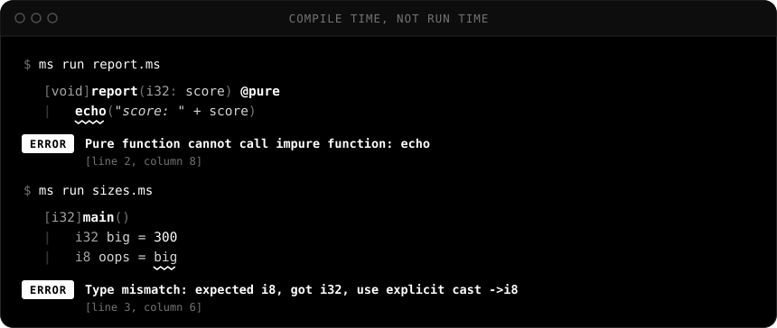
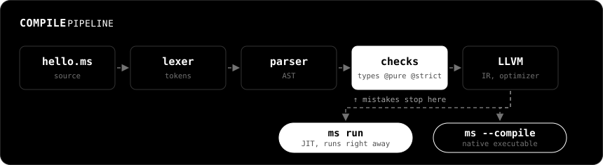
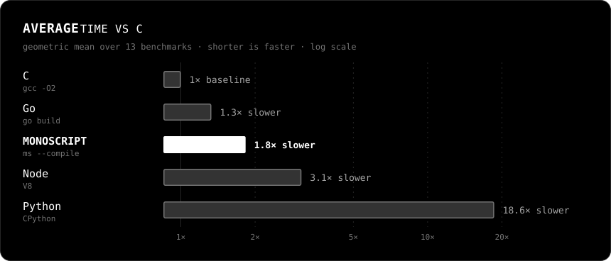

<div align="center">

<a href="https://github.com/MONOPTICAL/MONOSCRIPT">
  <picture>
    <source media="(prefers-color-scheme: dark)" srcset=".github/logo/logo-white.svg">
    
  </picture>
</a>

**A secure, readable, plugin-oriented language for writing system and application scripts in Kubernetes, security and automation**


[Language guide](LANGUAGE.md) · [Quick start](#quick-start) · [Performance](#performance) · [Status](#status)


</div>

<br>

<p align="center">
  
</p>

<br>

MONOSCRIPT is a small, statically typed language that **reads like a script and runs like C**. Write a plugin in a few minutes, run it instantly through the JIT, or ship it as a single native binary. The compiler checks types, purity and narrowing before anything runs, so the bug in the branch nobody tested never makes it to production.

- **Script-short.** Type inference, no boilerplate, `ms run file.ms` and you're done.
- **Checked before it runs.** Static types, no silent narrowing, `@pure` enforced by the compiler.
- **Strict where it matters.** Turn on `@strict` for one function, not for the whole project.
- **Fails gracefully.** Errors are values, and even runtime panics can be caught.
- **Native speed.** LLVM backend: a JIT for development, real executables for deployment.
- **Easy to extend.** Add native functions in **D** with one entry in a TOML file.

## Why another language?

Plugins for security and infrastructure tooling get written in a hurry, often in the middle of an incident, and then run unattended for months.

Python is great for the hurry and bad for the months: a typo in an untested branch waits until 3 a.m. to fire. C++ or Rust would catch it, but nobody wants to fight a systems language for a 40-line port scanner.

MONOSCRIPT sits in between. You write it like a script, the compiler checks it like a systems language, and LLVM turns it into native code.

## The compiler has your back

<p align="center">
  
</p>

These are real messages from `ms`. A few of the rules behind them:

**`@pure` is checked, not a comment.** A pure function can't print, can't touch globals and can't modify its arguments.

**Nothing narrows behind your back.** `i8 → i32` happens on its own. `i32 → i8` needs `->i8`, so you always see where data can be lost.

**Strictness is per function.** Quick code stays quick. Code that matters gets `@strict`: no implicit casts and no inference, only in that function.

```go
[i32]quick()
|   i8 small = 5
|   i32 wide = small          // widens on its own
|   return wide

[i32]careful() @strict
|   i8 small = 5
|   i32 wide = small->i32     // here you have to say it
|   return wide
```

**You can see the nesting.** Blocks are marked with `|`, so the shape of the code sits right there in the left margin. No invisible whitespace rules and no brace hunting.

## Failing without falling over

A plugin that crashes on one bad line of input is a plugin nobody trusts. Something that can fail returns `result<T>`, and `?` lets you unwrap it, fall back or bail out. Runtime panics such as an out-of-bounds index can be caught too:

```go
[i32]main()
|   port ^= toInt("80x")? else 8080      // bad input, falls back to 8080
|
|   attempt
|   |   array<i32> rows = [port]
|   |   echo("" + rows[9])               // out of bounds
|   panic info
|   |   echo(info.message + " at line " + info.line)
|   return 0
```

```
index 9 out of bounds (len 1) at line 6
```


## How it works

<p align="center">
  
</p>

The same front end feeds both modes: `ms run` JIT-compiles and runs in about 60 ms, and `ms --compile` produces a standalone executable. Memory is managed by a garbage collector (Boehm), and references are never null.


## Performance

**In short:** a compiled MONOSCRIPT program runs about **1.8× slower than C** on average. That's in the same league as Go, **1.7× faster than Node** and **10× faster than Python**.

<p align="center">
  
</p>

### What is compared

Thirteen small programs, each written the same way in every language: same algorithm, same input, same output. Before timing anything, the runner checks that all versions print exactly the same thing.

| | Version | How it runs |
|---|---|---|
| **MONOSCRIPT** | this repo, LLVM 22 | native binary from `ms --compile` |
| C | gcc 16.2 (and clang 21.1) | `-O2`, the 1× baseline |
| Go | 1.27 | `go build` |
| Node | 24.19 | V8 JIT |
| Python | 3.14 | CPython |

<p align="center">
  
</p>

### What this tells you

- **Plain number crunching is basically C.** Loops, `mandelbrot`, `spectral` and `sort` land within 1.3× of C, and sometimes level with it. LLVM is doing its job.
- **Strings, maps and allocation are where it falls behind.** `strings`, `mapstr`, `parse` and `bintree` run at 2–3× C, because every string and object goes through the garbage collector. This is where the work goes next.
- **Calls have a small price.** Every call carries the panic channel and a stack-depth check, which is what lets `panic` handlers catch errors from deep inside. Recursion-heavy `fib` pays for that with 3.8×.

<details>
<summary><b>All numbers</b>: mean wall time in milliseconds</summary>

<br>

| Benchmark | What it does | MONOSCRIPT | C gcc | C clang | Go | Node | Python |
|---|---|---:|---:|---:|---:|---:|---:|
| `fib` | `fib(32)`, recursive | **15** | 4.0 | 6.3 | 15 | 61 | 317 |
| `loops` | 50M iterations of integer math | **137** | 142 | 114 | 237 | 2 209 | 11 211 |
| `mandelbrot` | 1000×1000 grid, 200 iterations, `f64` | **203** | 203 | 197 | 205 | 242 | 6 591 |
| `spectral` | spectral norm, n=1500 | **147** | 114 | 111 | 155 | 261 | 13 986 |
| `matmul` | 400×400 `array<array<f64>>` | **81** | 36 | 25 | 61 | 140 | 2 791 |
| `sort` | quicksort of 2M items | **216** | 186 | 178 | 219 | 474 | 4 397 |
| `sieve` | primes up to 20M | **253** | 181 | 182 | 186 | 274 | 2 147 |
| `structs` | 500k structs, methods, 40 passes | **148** | 81 | 84 | 119 | 848 | 2 646 |
| `mapint` | `map<i64, i64>`: 1M inserts, 2M lookups | **380** | 191 | 182 | 369 | 632 | 1 158 |
| `mapstr` | `map<string, i64>`: 1M increments | **267** | 105 | 104 | 126 | 272 | 496 |
| `strings` | 2M string concatenations | **384** | 160 | 161 | 108 | 216 | 612 |
| `parse` | 300k lines: `split` and `toInt` | **218** | 72 | 72 | 76 | 234 | 354 |
| `bintree` | binary trees, depth 16 | **1 015** | 452 | 482 | 432 | 265 | 1 514 |

Measured with [hyperfine](https://github.com/sharkdp/hyperfine): 2 warmup runs, at least 5 timed runs, process start included. Intel Core i5-1135G7, 16 GB RAM, Linux 7.2, November 2026, commit `174f6d4`. Averages are geometric means of the time relative to gcc.

</details>


## Quick start

You'll need CMake 3.24+, a C++20 compiler, LLVM, `dmd`, `gcc` and `libgc-dev`.

```bash
cmake -B build -DCMAKE_BUILD_TYPE=Release
```

```bash
cmake --build build
```

Write `hello.ms`:

```go
[i32]main()
|   echo("hello from MONOSCRIPT")
|   return 0
```

Run it through the JIT:

```bash
./ms run hello.ms
```

Or build a native executable:

```bash
./ms --compile hello hello.ms
```

Add `--timings` to see where the compile time goes, or run the test suite with `./ms --run_tests`.


## Status

MONOSCRIPT is young and the syntax can still change. Here's where it stands:

- [x] Numbers, strings, casts, `if` / `for` / `while`
- [x] Functions, recursion, modules, `@strict`, `@pure`, `@entry`
- [x] Arrays, maps, structs with methods
- [x] Generics and passing functions by name
- [x] `result<T>`, `?`, `? else`, `attempt` and panic handlers
- [x] Garbage collection, runtime errors with line numbers
- [x] JIT and native executables
- [ ] Standart library(mono)
- [x] Lambdas with closures, enums, overloading, generic structs, namespaces
- [ ] Pipes (`|>`)
- [ ] Null safety
- [ ] Embedding and sandboxing

Everything else, from types to the native ABI, is in the **[language guide](LANGUAGE.md)**.

## License

[GNU LGPL v2.1](LICENSE). Use it freely and embed it without opening your own code. Changes to the engine itself stay open.

<br>

<div align="center">
  <sub>MONOSCRIPT isn't trying to beat the big languages. It's trying to make small programs people can trust.</sub>
</div>
